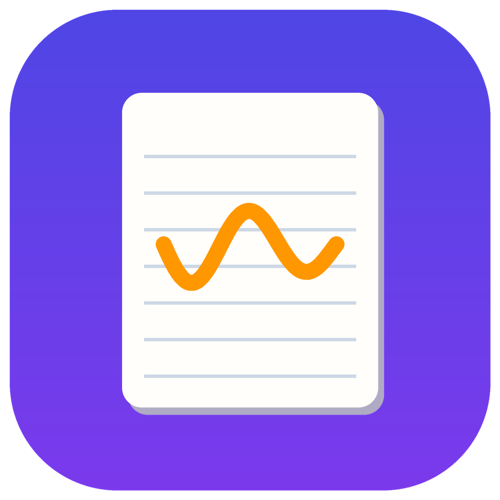

# FreeNotes

Eine kostenlose, quelloffene Handschrift-Notiz-App für Windows, Android und iPhone.
Schreiben mit Stift, Maus oder Finger, PDFs beschriften und alles automatisch auf
der eigenen NAS sichern. Kein Abo, kein Konto, keine Cloud eines Anbieters.



## Funktionen

- **Stifte:** Kugelschreiber, Füller, Bleistift und Textmarker, drucksensitiv mit Stylus (z. B. Surface Pen), je 3 Stärken
- **Farben:** Schnellfarben pro Stift plus eine Palette mit 18 Farben
- **Radierer** in 3 Größen; die Radierer-Seite eines Stylus funktioniert auch
- **Text und Bilder** auf der Seite einfügen, verschieben, Bilder vergrößern
- **PDF importieren** und direkt darauf schreiben
- **Zoomen und Verschieben:** zwei Finger, Touchpad, Strg + Mausrad, rechte Maustaste ziehen
- **Notizbücher** mit farbigen Covern, in **Ordnern** sortiert
- **Papier:** blanko, liniert, kariert oder punktiert, pro Seite wählbar
- **Suche** nach Notizbuch-Namen und getipptem Text
- **Rückgängig / Wiederholen** pro Seite
- **Handballen-Erkennung:** Sobald ein Stylus benutzt wurde, zeichnen Finger nicht mehr, sondern zoomen und verschieben
- **Automatisches Speichern** lokal und auf der **NAS (WebDAV)**, auch zwischen mehreren Geräten

## Installieren

Alle Dateien gibt es auf der Seite **[Neueste Version](../../releases/latest)**.

### Windows

1. `FreeNotes-Setup-x.y.z.exe` laden und ausführen. Es sind keine Administratorrechte nötig. Windows zeigt eventuell „Der Computer wurde durch Windows geschützt“, weil der Installer nicht signiert ist: **Weitere Informationen → Trotzdem ausführen**.
2. **An die Taskleiste heften:** Startmenü öffnen, **FreeNotes** suchen, Rechtsklick → **An Taskleiste anheften**.

Deinstallieren über *Einstellungen → Apps*. Deine Notizen bleiben dabei erhalten.

### Android

1. Am Handy im Browser die Seite **[Neueste Version](../../releases/latest)** öffnen und `FreeNotes-x.y.z.apk` antippen.
2. Die heruntergeladene Datei öffnen. Android fragt, ob der Browser Apps installieren darf: **Einstellungen → Aus dieser Quelle zulassen**, zurück, **Installieren**.
3. Falls Google Play Protect warnt („Unbekannte App“): **Weitere Details → Trotzdem installieren**. Die Warnung kommt, weil FreeNotes nicht aus dem Play Store stammt.

**Update:** neue `.apk` genauso installieren. Die Notizen bleiben erhalten.

### iPhone / iPad

Apple erlaubt Apps außerhalb des App Stores nur mit Umweg. Der kostenlose Weg ist **AltStore** mit deiner
normalen Apple-ID. Du brauchst dafür einmalig einen Windows-PC oder Mac.

**Einmalig einrichten (am PC):**
1. **iTunes** und **iCloud** direkt von apple.com installieren (nicht aus dem Microsoft Store).
2. **AltServer** von [altstore.io](https://altstore.io) installieren und starten (Symbol unten rechts in der Taskleiste).
3. iPhone per Kabel anschließen und „Diesem Computer vertrauen“ bestätigen. In iTunes beim iPhone **„Mit diesem iPhone über WLAN synchronisieren“** einschalten.
4. AltServer-Symbol anklicken → **Install AltStore** → dein iPhone → mit deiner Apple-ID anmelden.
5. Am iPhone: *Einstellungen → Allgemein → VPN & Geräteverwaltung* → deine Apple-ID → **Vertrauen**. Unter *Einstellungen → Datenschutz & Sicherheit* den **Entwicklermodus** einschalten (iPhone startet neu).

**FreeNotes installieren:**
1. Am iPhone in Safari die Seite **[Neueste Version](../../releases/latest)** öffnen und `FreeNotes-vx.y.z.ipa` laden.
2. **AltStore** öffnen → *Meine Apps* → **+** → die `.ipa`-Datei wählen.

**Wichtig:** Mit einer kostenlosen Apple-ID läuft die App 7 Tage. AltStore verlängert sie automatisch, wenn
iPhone und PC (mit laufendem AltServer) im selben WLAN sind. Alternativ in AltStore auf **Aktualisieren** tippen.
Mit einem Apple-Entwicklerkonto (99 €/Jahr) ginge es ohne Ablauf über TestFlight.

## Bedienung

| Aktion | So geht's |
|---|---|
| Zoomen | zwei Finger, Touchpad-Pinch oder **Strg + Mausrad** |
| Verschieben | Mausrad (mit **Umschalt** waagrecht), rechte Maustaste ziehen, zwei Finger |
| Ganze Seite zeigen | **Strg + 0** |
| Rückgängig / Wiederholen | **Strg + Z** / **Strg + Y** |
| Seite blättern | **←** / **→** |
| Text einfügen | Text-Werkzeug wählen, auf die Seite tippen |
| Objekt verschieben / löschen | Hand-Werkzeug, Objekt ziehen; **Entf** löscht es |
| Bild vergrößern | Hand-Werkzeug, am blauen Punkt unten rechts ziehen |

## Wo liegen meine Notizen?

Lokal in **Dokumente\FreeNotes**:

```
library.json          Ordner und Liste der Notizbücher
notebooks\<id>.json   Seiten eines Notizbuchs
assets\               importierte PDFs und Bilder
```

**Anderen Speicherort wählen** (z. B. ein zweites Laufwerk): Zahnrad → *Speicherort ändern…*. FreeNotes
verschiebt alle Notizen in einen Ordner `FreeNotes` am neuen Ort, löscht die alte Kopie erst, wenn alles
geprüft kopiert ist, und startet neu. Ist das Laufwerk später nicht angeschlossen, meldet FreeNotes das,
statt mit einem leeren Ordner zu starten.

Jede Änderung wird nach weniger als einer Sekunde gespeichert. Es wird zuerst in eine
Zwischendatei geschrieben und dann ausgetauscht, sodass ein Absturz nie eine halbe Datei hinterlässt.

## NAS-Synchronisierung (WebDAV)

FreeNotes speichert deine Notizbücher zusätzlich auf deiner NAS und gleicht sie zwischen
Geräten ab: beim Start, alle 2 Minuten, beim Schließen eines Notizbuchs und beim Beenden.

**Auf der NAS (Beispiel UGREEN, bei Synology/QNAP ähnlich):**
1. In der NAS-Weboberfläche **WebDAV** aktivieren (bei UGREEN: *Systemsteuerung → Dateidienste → WebDAV*). Wenn möglich **HTTPS** verwenden und dir den angezeigten Port merken.
2. In einem freigegebenen Ordner einen Ordner `FreeNotes` anlegen.

**In FreeNotes:** Zahnrad → *Einstellungen*
- **WebDAV-Adresse:** `https://NAS-IP:HTTPS-PORT/Freigabe/FreeNotes`
- **Benutzername / Passwort:** dein NAS-Konto (am besten ein eigenes Konto nur mit Zugriff auf diesen Ordner)
- **Eigenes Zertifikat der NAS akzeptieren:** einschalten, wenn die NAS ihr Standard-Zertifikat benutzt
- **Speichern und testen**

Adresse und Benutzername liegen nur auf deinem Gerät (im App-Datenordner). Das Passwort liegt in der
Windows-Anmeldeinformationsverwaltung. Nichts davon ist im Code oder in diesem Repository.

**Wenn auf zwei Geräten dasselbe Notizbuch geändert wurde**, bevor sie synchronisiert haben,
bleiben beide Versionen erhalten: Die NAS-Version erscheint als Kopie „Name (Konflikt)“.

## Selbst bauen

Voraussetzungen: [Flutter](https://docs.flutter.dev/get-started/install/windows), Visual Studio Build Tools 2022 mit
*Desktopentwicklung mit C++* und der Komponente *C++ ATL*, Windows-Entwicklermodus, [Inno Setup 6](https://jrsoftware.org/isinfo.php)
(nur für den Installer).

> Den Projektordner an einem Ort mit **kurzem Pfad** ablegen (z. B. `C:\dev\freenotes`).
> Bei sehr langen Pfaden scheitert der Build des PDF-Moduls an der Windows-Pfadgrenze.

```bash
flutter pub get
flutter test
flutter run -d windows
```

Installer bauen (Ergebnis in `dist\`):

```bash
powershell -ExecutionPolicy Bypass -File tool/build_installer.ps1
```

**Android-APK** (braucht zusätzlich das Android-SDK, z. B. über Android Studio):

```bash
flutter build apk --release
```

Ohne eigene `android/key.properties` wird mit dem Debug-Schlüssel signiert. Für Updates über eine
installierte Version muss immer derselbe Schlüssel verwendet werden.

**iPhone:** wird automatisch von GitHub Actions auf einem Mac gebaut (`.github/workflows/ios.yml`),
sobald ein Versions-Tag (`v…`) gepusht wird. Die `.ipa` landet am Release.

App-Icon ändern: `tool/make_icon.py` anpassen, dann `python tool/make_icon.py` und `dart run flutter_launcher_icons`.

## Projektaufbau

| Datei | Inhalt |
|---|---|
| `lib/main.dart` | App-Start, Speichern beim Beenden |
| `lib/model.dart` | Datenmodell: Notizbuch, Seite, Strich, Text, Bild, Ordner |
| `lib/ink.dart` | Stifttypen, Strich-Darstellung, Papier, Radierer-Treffertest |
| `lib/store.dart` | Lokales Speichern (automatisch, absturzsicher) |
| `lib/sync.dart` | WebDAV-Synchronisierung mit der NAS |
| `lib/library_screen.dart` | Startseite: Ordner, Notizbücher, Suche, PDF-Import |
| `lib/editor_screen.dart` | Editor: Zeichnen, Zoomen, Text, Bilder, Seiten |
| `lib/settings_screen.dart` | NAS-Einstellungen |
| `test/` | Tests für Sync, Radierer, Speicherformat, Speicherort-Wechsel und NAS-Ordnerliste |
| `installer/`, `tool/` | Windows-Installer, Build-Skript, Icon-Generator |
| `.github/workflows/ios.yml` | Baut die iPhone-App auf GitHub |

## Noch nicht enthalten

Export als PDF, Lasso-Auswahl, Formerkennung, Handschrifterkennung, Seiten-Miniaturansicht,
Installation über Play Store / App Store.

## Lizenz

MIT, siehe [LICENSE](LICENSE).
